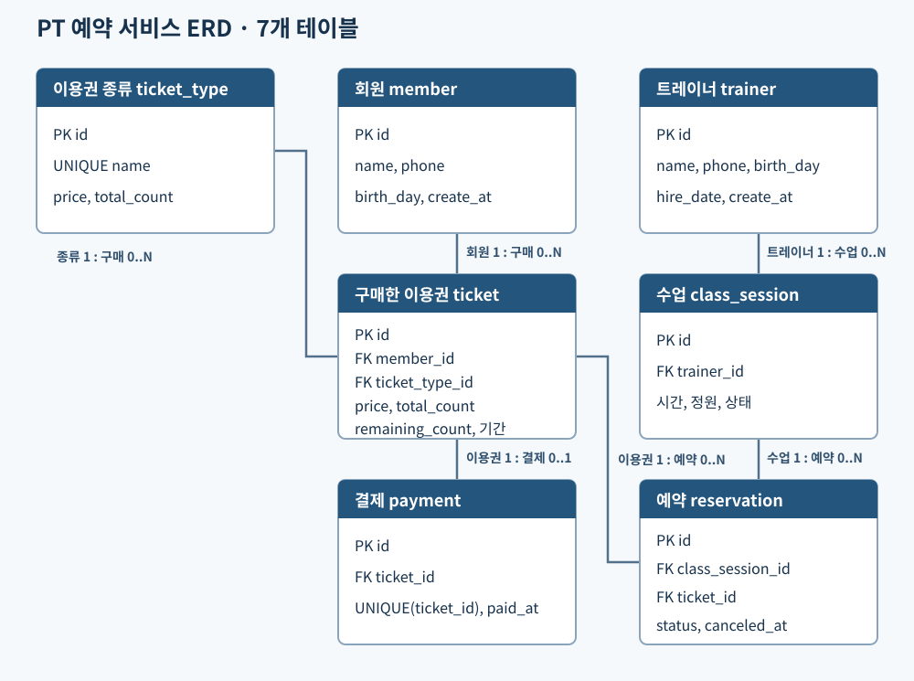

# 헬스 PT 수업 예약 서비스 데이터베이스 결과보고서 — 초안

> 작성 기준: 2026-11-12. 교수님이 요구한 문제·범위 → DB 설계 → 핵심 SQL → DB 프로그래밍 → 데이터 흐름 → 검증 → 결론 순서의 보고서 초안이다. SQL 4종과 별도 임시 DB에서 확인한 결과를 반영했다. 실행 화면 캡처와 팀원별 실제 담당 작업을 확정한 뒤 PDF로 변환한다.

## 1. 문제 정의와 구현 범위

헬스장 PT 수업을 수기로 관리하면 같은 시간의 중복 예약, 정원 초과, 이용권 잔여 횟수 불일치가 발생하기 쉽다. 이 프로젝트는 회원·트레이너·수업·이용권 종류·구매한 이용권·결제·예약을 관계형 데이터베이스로 관리하고, 상태와 제약조건을 명시하는 것을 목표로 한다.

구현 범위는 MySQL 데이터베이스의 개념·논리·물리 설계, 기본 데이터, 조회용 View, 인덱스, 트리거, 프로시저, 기능 검증용 SQL이다. 웹 화면과 서버 프로그램은 범위에 포함하지 않는다. 계획한 회원·트레이너·이용권·수업·예약의 DB 처리 기능 F-01~F-10을 프로시저로 정의했으며, 사용자 화면이나 서버 연동은 구현하지 않았다.

## 2. 데이터베이스 설계

### 2.1 현재 스키마 기준 ERD



*그림 1. 현재 `schema.sql` 기준 ERD. 이용권 종류는 구매자가 없어도 존재하며, 회원이 구매하면 `ticket`이 회원과 종류를 각각 참조한다.*

각 테이블의 `id`는 기본키이며 자동 증가한다. `ticket_type`은 구매 여부와 관계없이 이용권 종류를 정의한다. `ticket.member_id`는 회원, `ticket.ticket_type_id`는 이용권 종류를 참조한다. `payment.ticket_id`는 구매한 이용권, `class_session.trainer_id`는 트레이너를 참조한다. 예약은 `class_session_id`와 `ticket_id`로 수업과 이용권을 연결한다. 예약 회원은 `reservation → ticket → member` 경로로 확인하며, 예약 테이블에 회원 ID를 중복 저장하지 않는다. `payment.ticket_id`에는 `UNIQUE` 제약이 있어 이용권 한 장에 결제 기록을 하나만 연결한다.

관계 스키마의 키는 다음과 같다. `PK`는 기본키, `FK`는 참조하는 테이블을 뜻한다.

| 관계 | 기본키 | 외래키 및 고유 제약 |
|---|---|---|
| `member` | `id` | 없음 |
| `trainer` | `id` | 없음 |
| `ticket_type` | `id` | `UNIQUE(name)` |
| `class_session` | `id` | `trainer_id → trainer.id` |
| `ticket` | `id` | `member_id → member.id`, `ticket_type_id → ticket_type.id` |
| `payment` | `id` | `ticket_id → ticket.id`, `UNIQUE(ticket_id)` |
| `reservation` | `id` | `class_session_id → class_session.id`, `ticket_id → ticket.id` |

### 2.2 주요 컬럼과 제약조건

| 테이블             | 저장 내용                 | 주요 제약                              |
| --------------- | --------------------- | ---------------------------------- |
| `member`        | 회원 이름·연락처·생년월일·등록 시각  | 필수 정보 `NOT NULL`, 등록 시각 기본값        |
| `trainer`       | 트레이너 인적 정보·입사일        | 필수 정보 `NOT NULL`                   |
| `ticket_type`   | 판매할 종류 이름·기본 가격·제공 횟수 | 이름 `UNIQUE`, 가격 ≥ 0, 횟수 > 0 |
| `class_session` | 담당 트레이너·수업 시간·정원·상태   | 종료 > 시작, 정원 > 0, 상태 `OPEN`/`CLOSE` |
| `ticket`        | 소유 회원·종류·구매 가격·총/잔여 횟수·유효기간 | 회원·종류 FK, 가격 ≥ 0, 횟수 > 0, 잔여 횟수 0~총 횟수 |
| `payment`       | 이용권별 결제 일시            | 이용권 FK와 `UNIQUE(ticket_id)`        |
| `reservation`   | 수업·이용권·예약/취소 시각·상태    | 상태 4종 제한, 취소 상태와 취소 시각 일치          |

`ticket.price`와 `ticket.total_count`는 구매 시 `ticket_type`에서 복사한다. 종류의 가격·제공 횟수를 나중에 바꿔도 과거 구매 내역을 보존하기 위해서다. `ticket.expire_date`는 `start_date`에서 1년 뒤를 계산하는 생성 열이다. `reservation.status`는 `RESERVED`, `CANCELED`, `DONE`, `NO_SHOW`만 허용한다. 취소 상태일 때는 `canceled_at`이 있어야 하고 예약 시각보다 빠를 수 없다. 다른 상태에서는 취소 시각이 없어야 한다. 이 규칙들은 `schema.sql`의 `CHECK`, `NOT NULL`, FK 제약으로 정의했다.

테이블 제약만으로는 다른 행과 비교해야 하는 시간 중복, 정원 상태 전환, 이용권 횟수 차감까지 표현할 수 없다. 시간 중복과 상태 변경의 무결성은 트리거로, 여러 테이블에 걸친 구매·예약·취소는 트랜잭션을 사용하는 프로시저로 처리한다.

## 3. 기본 데이터와 데이터 흐름

`sample_data.sql`은 이용권 종류 2개, 회원 2명, 트레이너 2명, 구매한 이용권·결제 각 2건, 같은 시간의 수업 2개, 첫 수업의 예약 2건을 만드는 최소 사례다. 종류는 회원 등록보다 먼저 생성하며, 구매하지 않은 10회권도 조회할 수 있다. 수업 2개는 트레이너가 달라 같은 시간에 개설할 수 있다. 첫 수업은 정원 2명이 모두 예약하여 `CLOSE`, 두 번째 수업은 `OPEN` 상태가 되도록 구성했다. 각 회원의 5회 이용권은 예약 후 잔여 4회가 예상된다.

대표 흐름은 **이용권 종류 등록 → 회원 등록 → 종류를 선택해 이용권 구매 및 결제 기록 → 수업 개설 → 예약 생성 → 잔여 횟수·정원 상태 확인**이다. 수업과 회원을 연결할 때 예약에 직접 회원 ID를 저장하지 않고, 예약의 이용권을 통해 회원을 찾는다. 이 구조는 동일한 회원 정보가 여러 테이블에 중복 저장되는 것을 줄인다.

## 4. SQL 조회와 검증 현황

발표용 핵심 SQL은 `queries.sql`의 첫 부분에 모았다. 이용권 종류 조회는 구매 기록과 `LEFT JOIN`하여 구매자가 없는 10회권도 구매 수 0으로 표시한다. 다음 조회는 수업과 트레이너를 `JOIN`하고 예약을 `LEFT JOIN`하여 예약이 없는 수업도 표시한다. `COUNT`는 정원에 포함되는 `RESERVED`·`DONE`·`NO_SHOW`만 세며 `CANCELED`는 제외한다. 마지막 조회는 `EXISTS` 서브쿼리로 잔여 횟수가 있는 이용권을 한 장이라도 보유한 회원을 찾는다. 이용권이 여러 장이어도 회원을 중복 출력하지 않는다.

```sql
SELECT tt.id, tt.name, tt.price, tt.total_count,
       COUNT(t.id) AS purchase_count
FROM ticket_type tt
LEFT JOIN ticket t ON t.ticket_type_id = tt.id
GROUP BY tt.id, tt.name, tt.price, tt.total_count
ORDER BY tt.id;

SELECT c.id AS class_id, t.name AS trainer_name, c.max_members,
       COUNT(r.id) AS used_count,
       c.max_members - COUNT(r.id) AS available_count
FROM class_session c
JOIN trainer t ON t.id = c.trainer_id
LEFT JOIN reservation r
  ON r.class_session_id = c.id
 AND r.status IN ('RESERVED', 'DONE', 'NO_SHOW')
GROUP BY c.id, t.name, c.max_members
ORDER BY c.id;

SELECT m.id AS member_id, m.name AS member_name
FROM member m
WHERE EXISTS (
  SELECT 1 FROM ticket tk
  WHERE tk.member_id = m.id AND tk.remaining_count > 0
)
ORDER BY m.id;
```

별도 임시 DB에 `schema.sql` → `objects.sql` → `sample_data.sql`을 적용하고 세 조회를 실행했다. 이용권 종류별 구매 수는 5회권 2건, 10회권 0건이었다. 수업 집계 결과는 `1 / 오지훈 / 정원 2 / 사용 2 / 잔여 0`, `2 / 최유나 / 정원 2 / 사용 0 / 잔여 2`였다. 서브쿼리는 잔여 횟수가 있는 회원 김민지와 박서준을 각각 한 행씩 반환했다.

### 4.1 View와 인덱스

`objects.sql`의 `v_member_pt_summary`는 회원과 이용권을 `LEFT JOIN`하여 총 횟수·사용 횟수·잔여 횟수를 합산한다. 이용권이 없는 회원도 `COALESCE`로 0을 표시한다. `v_trainer_class_summary`는 트레이너별 수업 수와 유효 예약·완료·노쇼 건수를 집계한다. 두 View는 반복되는 요약 조회를 하나의 이름으로 제공하기 위해 사용한다. 기본 데이터 직후 별도 임시 DB에서 회원 View는 김민지와 박서준 각각 총 5회·사용 1회·잔여 4회를 반환했다. 아래 동시성 테스트 이후에는 성공한 회원의 사용 횟수가 2회, 잔여 횟수가 3회였다.

`idx_class_session_trainer_time(trainer_id, start_at, end_at)`는 트레이너별 수업을 찾아 시간 중복을 확인하는 조회를 지원한다. `idx_reservation_class_status(class_session_id, status)`는 수업별 유효 예약 수를 세는 조회를 지원한다. 로컬 DB에서 각 조회의 `EXPLAIN` 결과에 해당 인덱스명이 표시됐다. 샘플 데이터가 적으므로 속도 개선 폭은 측정하지 않았다.

## 5. DB 프로그래밍과 처리 흐름

### 5.1 프로시저

| 기능 | 프로시저 | 입력과 핵심 처리 |
|---|---|---|
| F-01·02 | `register_member`, `search_member` | 회원 등록 및 ID로 조회 |
| F-03·04 | `register_trainer`, `search_trainer` | 트레이너 등록 및 ID로 조회 |
| F-05 | `purchase_ticket` | 회원·이용권 종류·시작일을 받아 종류의 가격·횟수를 구매 기록에 복사하고 결제를 한 트랜잭션으로 저장 |
| F-06 | `create_class` | 시간·정원·트레이너 중복을 검사하고 `OPEN` 수업 생성 |
| F-07 | `available_classes` | 트레이너와 수업을 결합하고 사용 인원·잔여 정원 계산 |
| F-08 | `book_class` | 수업·이용권·결제·정원·회원 시간 중복을 검사하고 예약·횟수 차감·마감 처리 |
| F-09 | `cancel_reservation` | 예약 취소, 시작 48시간 전까지 횟수 복구, 정원 재개방 |
| F-10 | `mark_attendance` | 수업 종료 후 `DONE` 또는 `NO_SHOW` 기록 |

예약의 대표 흐름은 **수업 ID·이용권 ID 입력 → `book_class` 검증 → 수업·회원 행 잠금 → `reservation` INSERT → `ticket.remaining_count` 1회 차감 → 정원이 차면 수업 `CLOSE` → 예약 ID와 잔여 횟수 반환**이다. 구매·수업 개설·예약·취소·결과 기록은 오류 발생 시 `ROLLBACK`하는 처리로 구성했다. 예약 취소 시각이 수업 시작 48시간 전 또는 그 이전이면 횟수를 복구하며, 이후에는 복구하지 않는다. 결과 기록 시에는 이미 예약 단계에서 차감한 횟수를 다시 차감하지 않는다.

### 5.2 트리거와 Function

| 트리거 | 보호하는 규칙 |
|---|---|
| `class_session_overlap_insert` | 새 수업은 `OPEN`; 같은 트레이너의 시간 중복 등록 거부 |
| `class_session_time_change_guard` | 예약이 있는 수업의 시간·트레이너 변경 거부, 정원과 상태 일치 검사 |
| `reservation_member_overlap_insert` | 같은 회원의 겹치는 활성 예약 거부 |
| `reservation_identity_guard` | 예약의 수업·이용권 교체 및 확정된 상태 재변경 거부 |

트리거는 프로시저를 거치지 않은 직접 `INSERT`·`UPDATE`에도 위 무결성 규칙을 적용한다. 현재 별도의 SQL Function은 정의하지 않았다. 기간 계산은 생성 열, 집계는 View와 조회 SQL, 상태 변경은 프로시저에서 처리하므로 Function을 추가하지 않았다.

## 6. 검증 결과와 증빙

| 사례 | 입력·조건 | 확인 결과 |
|---|---|---|
| 기본 데이터 | 회원·트레이너 각 2명, 수업 2개, 첫 수업 예약 2건 | 첫 수업 `CLOSE`, 두 번째 수업 `OPEN`, 이용권 잔여 각 4회 |
| 이용권 종류 | 5회권·10회권 등록, 10회권은 미구매, 없는 종류로 구매 요청 | `LEFT JOIN`에서 구매 수 2·0, 없는 종류는 Error 1644 |
| 구매 시점 값 보존 | 구매 후 종류 가격을 250000원에서 300000원으로 변경 | 기존 `ticket.price`는 250000원 유지 |
| 핵심 JOIN·집계 | 두 수업의 트레이너·유효 예약 수·잔여 정원 조회 | 첫 수업 `2 / 0`, 두 번째 수업 `0 / 2` 반환 |
| `EXISTS` 서브쿼리 | 잔여 횟수가 있는 이용권을 보유한 회원 조회 | 김민지·박서준 각각 1행 반환 |
| View | 회원별 이용권 현황과 트레이너별 수업 현황 조회 | 두 View 생성 및 조회 성공 |
| 정상 조회 | 회원·트레이너·수업 ID로 조회 | 각 정보와 수업별 사용 인원·잔여 정원 반환 확인 |
| 인덱스 | 시간 중복·예약 상태 집계에 `EXPLAIN` | 두 조회에서 각각 해당 인덱스 사용 표시 |
| 동시 예약 | 별도 DB의 정원 1명 수업에 두 연결이 예약 요청 | 한 연결만 성공, 다른 연결은 Error 1644; 유효 예약 1건·수업 `CLOSE` |
| 동시 예약 후 이용권 | 각 이용권 시작 잔여 4회 | 성공한 회원만 3회, 실패한 회원은 4회 유지 |

동시성 검증은 임시 테스트 DB에서 예약 INSERT를 18초 지연시켜 두 요청을 겹치게 했다. 두 연결이 같은 수업을 예약하려 했으며, 먼저 수업 행 잠금을 얻은 요청이 커밋된 후 다른 요청은 `예약할 수 없는 수업입니다.` 오류로 종료됐다. 임시 지연 트리거는 테스트 후 삭제했고 기존 `pt_booking` DB는 변경하지 않았다. 이 검증은 두 요청이 충돌하는 한 사례의 결과이며 모든 동시 실행 상황을 대표하지는 않는다.

정상·예외 사례의 **실제 SQL 결과 화면과 오류 메시지 캡처는 아직 보고서에 첨부하지 않았다.** 최종본에는 입력값, 실행 SQL, 기대 결과, 실제 결과와 캡처를 한 사례씩 짝지어 넣는다. 48시간 취소 경계와 `NO_SHOW` 처리도 별도 증빙이 필요하다.

## 7. 결론과 최종본 반영 항목

현재 데이터는 기능을 보여주기 위한 최소 사례이므로 많은 데이터에서의 성능을 대표하지 않는다. 동시 예약은 정원 1명 사례에서 한 건만 저장되는 것을 확인했지만 다른 경합 상황까지 검증한 것은 아니다. 웹·서버 연동은 프로젝트 범위 밖이다. 기획서의 기존 ERD는 현재 스키마와 달라 최종 제출에는 이 문서의 현재 스키마 기준 ERD를 사용해야 한다. 다음 개선 방향은 취소 시각 경계와 `NO_SHOW`의 자동 검증, 더 큰 데이터에서의 실행 계획 비교다.

### 7.1 팀원별 담당 작업 — 확인 필요

| 팀원 | 실제 담당 작업 |
|---|---|
| 박준오 | 확인 후 기입 |
| 임장훈 | 확인 후 기입 |

담당 작업은 팀원별 실제 기여를 확인한 뒤 확정한다. 이름만으로 역할을 추정하지 않는다.

최종 제출 전 다음 내용을 확정한다.

1. 정상·예외 사례의 실행 화면과 SQL 결과 캡처, 48시간 취소 경계 및 `NO_SHOW` 검증을 추가한다.
2. 팀원별 실제 담당 내용을 확인해 기입하고, 최종 보고서를 PDF로 변환한다.

## 참고 파일

- `03_database/schema.sql`: 테이블, 키, 제약조건의 근거.
- `03_database/sample_data.sql`: 최소 기본 데이터와 예상 상태.
- `03_database/queries.sql`: 발표용 JOIN·집계·서브쿼리, View 조회, 기능 검증 및 실행 계획 확인용 쿼리.
- `03_database/objects.sql`: View 2개, 인덱스 2개, 트리거 4개, 프로시저 10개.
- `동시성 테스트 방법.txt`: 두 연결의 예약 충돌 테스트 절차와 결과.
- 교수님의 최종 제출·발표 안내: 최종 보고서에 문제·범위, DB 설계, SQL 적용, DB Programming, 데이터 흐름, 검증, 결론을 포함하도록 요구한다.
